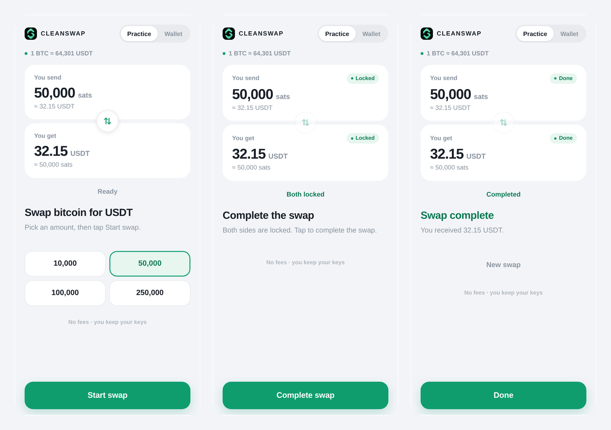

<p align="center">
  
</p>

<h1 align="center">CLEANSWAP</h1>

<p align="center"><b>Swap bitcoin for USDT — or USDT for bitcoin — with both sides locked before anything moves.</b></p>

<p align="center">
  
  
  
  
  
  
  
</p>

<p align="center">
  
</p>

CLEANSWAP is a non-custodial **Lightning bitcoin <-> USDT atomic swap**: one HTML file, no framework,
no wallet vendor, no custodian. Three steps - **1 the Lightning invoice, 2 the USDT address,
3 Approve** - and underneath them a Bitcoin-style SHA-256 hashlock that settles both legs with the
same 32-byte secret.

`v0.5.0` is the version that reads the chain. The USDT leg is a real HTLC on **Arbitrum** - the
`CleanSwapHTLC` contract, default network **Arbitrum Sepolia**, switchable to **Arbitrum One** - and
the app no longer believes the phone: the escrow is read over public JSON-RPC, and the swap only
closes when the contract says the USDT is locked for these terms and then claimed.

`v0.5.1` makes **Practice walk that same road**: `Approve` no longer jumps to a finished swap. A
rehearsal parks on the same **Waiting for payment** screen, with the same invoice hand-off, the same
`Check chain` and `I paid`, and closes only when the stand-in escrow says the USDT was claimed. The
two modes differ in exactly two things: `Sample` beside the two inputs, and a stand-in escrow on the
phone instead of a deployed one (so a rehearsal is never written to Recent).

## What `v0.5.1` does

* **The same three steps as ever.** `1 Partner's Lightning invoice` (an `lnbc...` invoice or an
  `lno1...` offer the other side wants paid) -> `2 Your USDT address` (the `0x...` that receives the
  USDT on Arbitrum) -> `3 Approve`. Practice and Wallet build the same screen from the same markup;
  a rehearsal cannot teach a different flow than the real thing. The direction flip still reverses
  the steps, `Sample` still exists in Practice and nowhere else.
* **The chain is the referee.** The escrow is read with `eth_call swaps(swapId)` against Arbitrum's
  public endpoints (`https://sepolia-rollup.arbitrum.io/rpc` for Sepolia,
  `https://arb1.arbitrum.io/rpc` and a publicnode fallback for One), with `eth_blockNumber` and
  `eth_getCode` as the check that the endpoint and the contract are really there before anything is
  approved, and `eth_getTransactionReceipt` for a transaction a wallet sent.
* **The swap id is the terms, so both phones can read the escrow before either one transacts.**
  `swapId = sha256(abi.encodePacked(hashlock, receiver, token, amount, timelock))` - the sender is
  deliberately *not* in it. A phone that knows the terms knows the id, asks the chain, and sees the
  escrow that the other side has already funded. The same id is what `lock` writes and what
  `claim`/`refund` answer.
* **The verdict comes in plain English.** `swaps(id)` returns the whole record; the app compares it
  against the terms on screen (hashlock, receiver, token, amount, timelock) and says one of: nothing
  locked yet / holds your X USDT until the swap closes or the window ends / paid out / sent back /
  not the agreed swap. A record that disagrees with the terms on screen is refused, not guessed
  about.
* **Nothing completes on a tap - in either mode.** In Wallet mode `Approve` is refused outright
  while the USDT is not in the escrow; once the chain says `locked`, the screen waits for the
  bitcoin payment; `I paid` starts a watch on the escrow (12 s poll) and **nothing** - not
  `I paid`, not `Check chain`, not a reload - closes the swap before the contract says `claimed`.
  A refunded record closes it as refunded, and the receipt says so. Practice runs the same
  sequence: `Approve` -> **Waiting for payment** -> `I paid` -> the same reading -> **Swap
  complete**, against the stand-in escrow, at rehearsal speed (a lock and a claim land a moment
  after the tap rather than waiting for a partner).
* **Signing stays in your wallet.** The app holds no key and never asks for one. With a wallet in
  the page (`window.ethereum`, EIP-1193 - an injected browser wallet) the approve/lock/claim/refund
  calls are sent from it, the USDT allowance is checked and an `approve` is requested only when it
  is short. Without one, the exact call (`to`, `data`, `chainId`) is copied as text for another
  wallet app, or opened as an **EIP-681** `ethereum:...` link, and the transaction hash is pasted
  back - the app reads the receipt itself and still judges only what the escrow says.
* **Setup is one panel, used once.** The chain line at the top (Arbitrum Sepolia / Arbitrum One)
  opens it: the escrow contract address, the USDT token address, an optional private RPC endpoint.
  With no contract set, the panel offers the deploy hand-off: **Copy bytecode** (solc 0.8.26
  creation code, embedded in the page) and **Open Remix**. The setup survives in `localStorage`
  under one key; a `cleanswap:` code from the other side carries the chain and the contract too.
* **A BOLT12 offer is a payment target, not a rejection.** Pasting `lno1...` is accepted:
  `Open in wallet` becomes `lightning:lno1...`, the QR carries it. An offer has no `payment_hash` of
  its own, so the swap binds to the offer itself (see below). BOLT11 hold invoices stay fully
  accepted.
* **The terms leave as a code, not as a web address.** `Share code` copies `cleanswap:...`
  (base64url JSON: both amounts, the window, the hashlock and the USDT address, plus the chain and
  the escrow in Wallet mode - still under the 340-byte QR budget). No host, no path, no name,
  nothing taken from `location.href`.
* **`<- Back` from a running or finished swap** returns to the filled-in form; a swap nobody paid
  is not quietly settled by leaving it.

## The three steps

| Step | On screen | What is checked before `Approve` moves |
| --- | --- | --- |
| 1 | the Lightning invoice or offer - `Open in wallet`, `Copy`, `QR` in both modes, `Sample` in Practice only | bech32 checksum, `payment_hash` present (or a well-formed `lno1...` offer, which binds the swap to itself), amount equal to the swap, not expired, `bc` network, and - when a code arrived first - a hash equal to the one that code pinned |
| 2 | the USDT address | an Arbitrum `0x` address with exactly 40 hex characters, not the zero address. In Wallet mode a TRON `T` address is decoded and checked, then refused with the reason: this swap pays on Arbitrum |
| 3 | `Approve` | the two are bound to one `H`, and in Wallet mode the chain is asked before anything else happens: endpoint alive, contract deployed, escrow state for `swapId` |

Anything refused is named in plain English and never in jargon, and the hidden log keeps the decoded
fields for a support question.

## Wallet mode - the real escrow

<p align="center">
  
</p>

A swap in Wallet mode runs on the chain, and every step that touches USDT has the contract behind it:

1. **You send bitcoin** (`btc2u`): the *partner* locks the USDT first. `Approve` reads the escrow;
   nothing there (or a record for different terms) stops the swap with a sentence. Once the chain
   says `locked`, the screen becomes **Waiting for payment**: the invoice, `Open in wallet` /
   `Copy` / `QR`, and `I paid` below.
2. **`I paid` starts the watch.** The screen changes to **Paid, waiting for the USDT** and polls the
   escrow every 12 s. When your partner reveals the secret R in a `claim`, the record flips to
   `claimed` and the swap closes - on the chain's word, not yours. `Check chain` reads it sooner;
   `Paste tx` takes a transaction hash instead.
3. **You send USDT** (`u2b`): `Approve` builds the `lock()` call from the terms on screen. With a
   wallet in the page, the allowance is checked first and the approve + lock are sent from it;
   without one, `Copy call` / the `ethereum:` link carry the call to another wallet and `Paste tx`
   brings the hash back. The app reads the receipt, then the record: only `locked` moves the swap
   to waiting, only `claimed` completes it.
4. **The window runs out**: the refund button appears for your side of the escrow, and a record
   that says `refunded` closes the swap as **Swap closed**, with the receipt saying the USDT went
   back.

<p align="center">
  
</p>

Completed swaps land as one-line entries under **Recent**, and the receipt names the chain it
settled on (`Arbitrum Sepolia · paid on chain`).

**Practice mode** runs the identical screen, gates and readings against an in-page stand-in for the
escrow: the same `swaps(id)` record shape, the same classifier, the same sentences, the same
**Waiting for payment** / `I paid` / **Paid, waiting for the USDT** screens. The chain line at the
top names Arbitrum Sepolia and the stand-in escrow, so nothing has to be deployed to rehearse. The
receipt says `Practice · simulated`. A rehearsal is never written to Recent.

---

## On-chain architecture (Arbitrum Sepolia / Arbitrum One)

```
   bitcoin leg (Lightning)                    USDT leg (Arbitrum)
   -------------------------                  -------------------------
   invoice/offer, payment_hash H    <------>  CleanSwapHTLC.lock(H, T2, receiver, token, amount)
   paid by the BTC payer                      swapId = sha256(H ‖ receiver ‖ token ‖ amount ‖ T2)
            |                                          |
            |  the same 32-byte secret R               |  claimed: swapId, R
            v                                          v
   whoever holds R settles both         CleanSwapHTLC.claim(swapId, R): sha256(R)==H,
   (reveal R in the claim)              USDT transferFrom escrow to receiver, Claimed(R)

   timeout path:            CleanSwapHTLC.refund(swapId) after T2 - tokens back to the sender
   app's view of it all:    eth_call swaps(swapId) - 8 words: hashlock, amount, timelock,
                            token, sender, receiver, claimed, refunded
```

* **The swap id is computed off the terms, not off the sender.** Both phones compute
  `sha256(abi.encodePacked(hashlock, receiver, token, amount, timelock))` as soon as the terms are
  on screen, so the app can watch an escrow the other side has not funded yet - and a record found
  under that id is compared field by field against the terms before it is believed.
* **Arbitrum parameters.** Sepolia test chain id `421614` (`0x66eee`), One mainnet chain id
  `42161` (`0xa4b1`). Both are offered in Setup, Sepolia by default; the mainnet token is the
  6-decimal USDT at `0xFd086bC7CD5C481DCC9C85ebE478A1C0b69FCbb9` (the app also reads `decimals()`
  semantics at 6 and shows the USDT amount the way a wallet does).
* **Public endpoints, in order.** Sepolia: `sepolia-rollup.arbitrum.io/rpc`. One:
  `arb1.arbitrum.io/rpc`, then `arbitrum-one-rpc.publicnode.com`. A private endpoint typed in Setup
  replaces them all - a person who runs their own node did not ask for a public one to be asked
  instead. A failed request walks to the next endpoint; an on-chain revert (a call that does not
  exist, an unknown swap) stops the walk, because a second node cannot change that answer.
* **No key ever enters the app.** EIP-1193 injection (`window.ethereum`) sends what the page cannot
  sign; everything else is a copy/link/paste hand-off. The app reads, computes and judges; the
  wallet signs.
* **`contracts/CleanSwapHTLC.sol`** - `^0.8.26`, custom errors, packed struct, one slot of
  booleans, checks-effects-interactions, no owner, no fees, no proxy. `lock` pulls the token via
  `transferFrom`, `claim` reveals R and pays the receiver, `refund` returns to the sender after
  `timelock`; `swaps(swapId)` is the public getter the app reads; `computeSwapId(...)` mirrors the
  app's own packed SHA-256. Events: `Locked`, `Claimed` (with R in the clear), `Refunded`.
  `contracts/TestUSDT.sol` is a throwaway 6-decimal ERC-20 with `faucet()` for Sepolia.
* **Timelock asymmetry is the safety margin**: the Lightning leg must outlive the token leg
  (`T1 > T2`); the contract refuses a timelock closer than `MIN_TIMELOCK_DELTA` (5 minutes) so a
  refund cannot race a claim.

### Lightning side: BOLT12 by default, BOLT11 fully accepted

One reader takes anything: `lno1…` (BOLT12 offer), `lni1…` (BOLT12 invoice), `lnbc…`/`lntb…`
(BOLT11), with or without the `lightning:` prefix.

* **BOLT12 encode** (`lno1…`) — the app mints offers for a swap: TLVs over bech32 without a
  checksum, amount in the HRP (msat), `offer_description`, `offer_absolute_expiry`, a node id and a
  64-byte signature slot. An offer cannot carry a `payment_hash` by itself, so the swap hashlock
  rides in a **custom type-80 TLV**; a minted invoice (`lni1…` shape) carries the standard
  `invoice_payment_hash` (type 168).
* **BOLT11 encode** (`lnbc…`) — hold invoices: bech32 checksum, 35-bit timestamp, `p`/`d`/`x`
  tagged fields, a 65-byte signature slot, `payment_hash = H`.
* Wallet hand-off: `lightning:<offer|invoice>` deep link, one-tap copy, and a locally generated QR
  (own encoder, byte mode, EC level M — falling back to L for long requests — versions 1–13).

> Honest limit: an offer from someone else's wallet (Lexe, say) has no `payment_hash` field, so the
> swap binds to the offer string itself - `H = SHA-256` of the offer's TLV bytes - which is
> deterministic, identical on both phones, and travels in the `cleanswap:` code. Garbage,
> truncation and text that only resembles an offer are refused at the gate.

### What the screen deliberately hides

The verification did not get weaker, it moved out of sight. The hidden event log (`#log`) records
every decoded field, hash comparison and refusal for a support question. Addresses, hashes and
selectors appear only where the person swapping needs none of them: the Setup panel (deploy), the
copied call (wallet hand-off) and the log.

---

## Repository layout

```
ln-usdt-swap.html            built single-file app (also dist/cleanswap.html)
build.py                     src/ -> single file (+ the APK asset); refuses to emit Hangul;
                             compiles the escrow and embeds its creation bytecode
src/
  index.template.html        screen markup: two cards, three steps, one Approve bar, the setup panel
  app.css                    light payment-app theme, fixed action bar, mobile-first
  app.js                     JSON-RPC client, escrow ABI + swap id, gates, BOLT11/12, wallet hand-off
  qr.js                      dependency-free QR encoder (byte mode, 1-13, L/M/Q/H)
contracts/
  CleanSwapHTLC.sol          sha256 hashlock, ERC-20 escrow, timelock refund, swaps(id) getter
  CleanSwapHTLC.bin          creation bytecode, checked against the source by the build and the tests
  TestUSDT.sol               6-decimal faucet token
docs/                        icon and screens, regenerated from the built app
tools/                       invoice minting, icons, QR and doc-shot helpers
test/
  headless.js                Playwright end-to-end suite, with a mock JSON-RPC endpoint on 127.0.0.1
  contract-evm.py            contract behaviour on py-evm + the page's ABI against eth_abi
  qr-crosscheck.py           QR matrices vs python-qrcode (64 fixed-mask matrices)
  invoice-crosscheck.py      minted invoices vs an independent BOLT11 decoder
  verify-english.py          Hangul must be 0 in every text file, path and commit
  run-all.sh                 everything above with the right env
android/                     WebView wrapper (com.jbitmstr.cleanswap, v0.5.1, versionCode 8)
```

## Build

```bash
python3 build.py     # -> ../ln-usdt-swap.html, dist/cleanswap.html and the APK asset
```

solc 0.8.26 (`.tools/solc-*` or `$SOLC`) compiles the escrow; its creation bytecode is embedded in
the page for the Setup panel's deploy hand-off, and `contracts/CleanSwapHTLC.bin` is checked against
the same source. The output is one self-contained file. Network use: the optional BTC/USD quote from
`mempool.space`, and the Arbitrum JSON-RPC reads of the escrow. The build fails if any source file
contains a Hangul character.

## Verification & test results

All suites pass on this tree:

| Suite | What it proves | Result |
| --- | --- | --- |
| `test/headless.js` (Playwright + a mock Arbitrum JSON-RPC endpoint on 127.0.0.1) | The three steps in both modes, the flip, invoice and address refusals, BOLT12 offers, the `cleanswap:` code round trip (chain and escrow included, still QR-sized), Practice walking the same road (Approve -> the waiting screen with `I paid` -> the lock alone finishing nothing -> the stand-in claim completing the swap, no Recent entry, and no request leaving the phone), and the whole wallet flow against real `eth_call` responses: nothing locked -> Approve refused; `locked` -> the payment starts; `I paid` -> watching, no receipt; endpoint down -> nothing completes and the line says why; record for another amount -> refused; `claimed` -> the swap completes and the receipt names the chain; the USDT side: the lock call (copy / EIP-681 / ABI shape), a pasted tx hash read back through `eth_getTransactionReceipt`, a wrong secret refused before any wallet sees it, and a `refunded` record closing the swap as refunded | **247/247 pass** |
| `test/contract-evm.py` (solc 0.8.26 + py-evm + eth-abi) | Real bytecode: `lock` escrows and debits, `swaps(id)` returns the 8-word record and eight zero words for an unknown id, `claim` with the right preimage pays the receiver and emits R, double claim reverts, refund before/after the timelock, `computeSwapId` = the id `lock` used - and every selector the page sends equals keccak of the contract signature, the committed bytecode matches the source, and the mock endpoint's answer equals what `eth_abi` encodes for the same record | **32/32 pass** |
| `test/qr-crosscheck.py` | Every module of every mask (0–7) across eight payloads matches `python-qrcode` | **64/64 matrices equal** |
| `test/invoice-crosscheck.py` | Every invoice the app mints parses under an independent Python BOLT11 decoder | **45/45 pass** |
| `test/verify-english.py` | Hangul count is 0 across every tracked text file, file name and commit message | **0 characters** |

```bash
bash test/run-all.sh      # build + English + headless + EVM + QR + invoices
```

Screenshots of the form, the wallet flow (waiting, paid, settled, refunded), the setup panel, the
blocked form, the lock hand-off and the code QR are written to `shots/v5*-*.png` by the headless
suite.

## Deploying the escrow (once per network)

1. Wallet mode -> the chain line -> **Setup**.
2. Pick the network. **Copy bytecode**, open **Remix**, paste it as one file with the `// SPDX`
   line removed (or paste `contracts/CleanSwapHTLC.sol` from this repository and compile with
   solc 0.8.26), deploy with your wallet - Sepolia for a rehearsal.
3. Copy the deployed address, and the token address (deploy `TestUSDT.sol` on Sepolia and tap its
   `faucet()`; on One it is USDT's own contract), into Setup and **Save**.
4. `Check` reads the chain and tells you the escrow has code. Everything else stays on the phone;
   the other phone learns the address from a `cleanswap:` code.

## Android wrapper

`android/` is a dependency-free `WebView` shell (package `com.jbitmstr.cleanswap`, `versionName
0.5.1`, `versionCode 8`). The shell owns the hand-offs the WebView cannot: `lightning:`, `bitcoin:`
and now `ethereum:` links (the EIP-681 call) become an `ACTION_VIEW` intent, so **Open in wallet**
and the escrow call open the installed wallet instead of failing with
`net::ERR_UNKNOWN_URL_SCHEME`; a phone with no such app gets a toast rather than a crash, and the
manifest declares a `<queries>` entry for all three schemes so Android 11+ package visibility does
not hide them. The `cleanswap:` scheme intent filter is unchanged: a code handed over by another app
opens CLEANSWAP on it.

GitHub Actions builds `cleanswap.apk` on every push to `main` and on `v*` tags
(`.github/workflows/apk.yml`); the same file is kept under `android/ci/build-apk.yml` for reference.
The APK is uploaded as a workflow artifact.

## Security notes and limitations

* This is a **prototype**. The contract is minimal by design and **has not been audited**; do not
  escrow real value with it. On Arbitrum One, real USDT is real money.
* The app reads the chain and builds calls; it never signs. Anything it says is settled on-chain is
  read from the contract, and everything else it says is a sentence, not a receipt.
* The read path is the page's own JSON-RPC client against public endpoints (or the one you set). A
  hostile endpoint could lie about `swaps(id)`; the terms are re-checked against the record, but a
  node that lies about the whole record is outside what a read-only client can detect. Run your own
  endpoint for real value.
* A `cleanswap:` code carries terms only. It is not a web address, has no host, and is never built
  from the page's own URL.
* A swap lives in the page: reloading it forgets it. The Setup panel is the only thing kept, in one
  `localStorage` key.
* Minted offers and invoices carry deterministic filler signatures; they parse, checksum and hash
  correctly, but no node will route them.
* The UI, code, tests and commit messages are English only, and `test/verify-english.py` enforces it.

## Contributors

- [@JBITmstr](https://github.com/JBITmstr)
- Gilbert ([Pickle](https://pickle.com))

## License

MIT for the code in this repository. The CLEANSWAP name and icon belong to the project owner.
