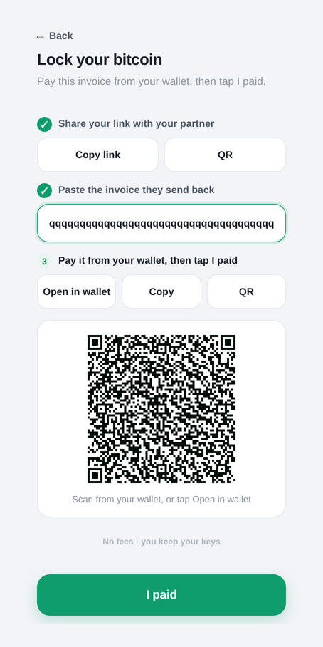

<p align="center">
  
</p>

<h1 align="center">CLEANSWAP</h1>

<p align="center"><b>Swap bitcoin for USDT — or USDT for bitcoin — with both sides locked before anything moves.</b></p>

<p align="center">
  
  
  
  
  
  
</p>

<p align="center">
  
</p>

CLEANSWAP is a non-custodial **Lightning bitcoin ↔ USDT atomic swap** prototype: one HTML file, no
framework, no browser extension, no wallet vendor, no custodian. Two amount cards, one plain
sentence and one big button per step — and underneath them a Bitcoin-style SHA-256 hashlock that
settles both legs with the same 32-byte secret.

`v0.4` is the version that stopped explaining itself. There are no symbol names, no hashes, no raw
hex and no test buttons on the screen; the app says what to do next in one short sentence, and the
sample and mismatch helpers of the practice sandbox are gone entirely. Everything the old screen
showed for show — `Preimage R`, `H`, `Escrow proof`, `Wallet receipt · payment hash`, `T1 · block`,
`T2 · unix`, `lno1… / lni1… / lnbc…` — is now checked in the background and never printed. What is
left is a payment-app screen: **Practice | Wallet**, one rate line, two cards, a short state
(`Ready` → `Bitcoin locked` → `Both locked` → `Completed`), and a single action.

## What `v0.4.1` adds

`v0.4` was one clean screen per step, which left two things unsaid: **where you are in the swap**,
and **how to get back**. `v0.4.1` keeps the same one-sentence rule and fills exactly those gaps.

* **`← Back` on every step after `Start swap`.** Before anything is locked it returns straight to
  the amount screen; once a side is locked it asks first, in a small sheet (`Stay` / `Leave`) that
  says what happens to the locked money. There is no way to throw a running swap away with a stray
  tap, and no way to get stuck on a step either.
* **A three-stage tracker instead of empty space.** Practice used to show a title, a sentence and a
  button, and nothing else. Now a white card walks the swap through **1 Lock your side → 2 Partner
  locks → 3 Settle at once**, with the amount named at each stage, a green tick when a stage is done,
  and one line underneath that says the whole safety argument: *nothing moves until both sides are
  locked.* The same tracker appears in Wallet mode once the invoice step is behind you.
* **`Partner cancels` — the case the swap exists for.** Practice now has one small helper that lets
  you watch the guarantee instead of reading about it: after you lock, the partner walks away, and
  the locked amount comes back. That is the whole point of the hashlock — either both sides lock and
  swap at once, or nothing is exchanged.
* **Wallet mode says what to do in order.** `Start swap` no longer opens on a blank field: the first
  step is a numbered path — **1 Share your link** (`Copy link` / `QR`) → **2 Paste the invoice they
  send back** → **3 Pay it from your wallet** (`Open in wallet`, `Copy`, `QR`), with the step in hand
  highlighted and the ones ahead dimmed.
* **Real wallet invoices are accepted — and bound, not waved through.** A normal `lnbc…` / `lntb…`
  invoice carries its own `payment_hash`; Wallet mode adopts that hash as the swap's `H` (and drops
  the local secret, because the partner now holds it) so the USDT `lock()` and the Lightning leg sit
  on the *same* hashlock. A `lni1…` BOLT12 invoice is read the same way. Nothing weakens: a bad
  checksum, an expired invoice, an amount that is not the swap's amount, an offer with no payment
  hash, or a USDT lock on a different hash are all still refused in plain words.
* **`Open in wallet` and `QR` are never a dead tap.** A good invoice immediately gets its QR on
  screen and the deep link carries it; before that, tapping either one says *Paste the invoice first*
  and shakes the field, instead of doing nothing.
* The amount cards fold into one quiet summary while a swap runs, so the steps fit a phone screen.

## The four taps

Practice mode is the whole swap on one screen; nothing is pasted and nothing is typed.

| Tap | Button | What the app verifies before it moves |
| --- | --- | --- |
| 1 | `Start swap` | a fresh 32-byte secret `R`, `H = SHA256(R)`, a 40-block Lightning window and a one-hour token window |
| 2 | `Lock my BTC` (or `Lock my USDT`) | the partner's invoice decodes, its payment hash is exactly `H`, its amount equals the swap, and it is still inside its expiry window |
| 3 | `Partner locks` | the partner's escrow decodes from `lock()` calldata to the **same `H`**, the **same `T2`** and the **same USDT amount** |
| 4 | `Complete swap` | `SHA256(R) === H`, computed with WebCrypto; the hashlock releases both legs at once |

Then `Done` (or `New swap`) returns to the start. A tap alone never advances: if a check fails the
button shakes, the button stays where it is, and the sentence says in plain English what is wrong
("That invoice is for a different swap."). Practice swaps are **not** kept in the history — only a
real swap is. At any point after `Start swap`, `← Back` is one tap away, and `Partner cancels` shows
the other ending: the partner never locks, nothing is exchanged, and what you locked comes back.

## Wallet mode — a real hand-off

Practice replaces the counterparty with a simulator; **Wallet** replaces it with a real one. What
stays on screen is only what a real swap needs, in the order a real swap needs it:

| Step | On screen | What it does |
| --- | --- | --- |
| 1 | `Share your link with your partner` — `Copy link`, `QR` | the swap link carries the hashlock; the partner opens it, or takes the invoice from it |
| 2 | `Paste the invoice they send back` — one single-line field | decodes the invoice, adopts its `payment_hash` as `H`, checks amount and expiry |
| 3 | `Pay it from your wallet, then tap I paid` — `Open in wallet`, `Copy`, `QR` | the standard `lightning:` deep link into BlueWallet / Wallet of Satoshi / Lexe / AQUA / Blockstream Green; the QR appears the moment the invoice checks out |

The USDT side gets a `Copy link` / `QR` invite instead, and after locking shares the invoice the
partner pays. There is no WebLN, no browser extension and no key request — the app never signs
anything, and nothing is paid except in your own wallet.

**A real wallet invoice binds the swap.** Wallets do not know about this app, so the invoice they
issue carries *their* `payment_hash`, not the one this screen minted. Wallet mode treats that hash
as the swap: it is adopted as `H`, the local secret is dropped (the partner holds the preimage now),
the swap id is recomputed, and the USDT `lock()` calldata the partner is asked for is built from the
same `H`. One hashlock, both legs — the atomicity is the same as in practice; only who holds the
secret changed. What is *not* accepted: an invoice whose bech32 checksum does not hold, one that has
expired, one for a different amount (`That invoice is for 25,000 sats, not 50,000.`), a bare
`lno1…` offer that carries no payment hash to lock on, or a USDT lock encoded against another hash.

<p align="center">
  
</p>

Completed real swaps land as one-line entries under **Recent** (`+32.15 USDT`, `+50,000 sats`).

## Both directions

One tap on the switch between the two cards flips the home screen: *you send bitcoin* (create the
swap, lock bitcoin, the partner locks USDT) or *you send USDT* (lock USDT first, the bitcoin side
pays your invoice). The amount, the direction and the mode freeze once a swap is open, so the
numbers on screen are the numbers in the hashlock.

A **share link** (`#s=1.<H>.<sats>.<units>.<T2>.<T1>`) still opens the same swap on another phone
as the USDT side: same hashlock, no preimage, its own steps, and it can only finish when the
bitcoin side reveals the secret.

---

## Cryptographic & contract architecture

### Hashlock: `sha256`, never `keccak256`

Bitcoin scripts enforce `OP_SHA256`; a Lightning HTLC's `payment_hash` is the SHA-256 of the
preimage (`BOLT 4`). The token leg therefore locks against the *same primitive*:

```solidity
bytes32 computed = sha256(abi.encodePacked(preimage));
if (computed != s.hashlock) revert HashlockMismatch(s.hashlock, computed);
```

`abi.encodePacked(bytes32)` is exactly the 32 raw bytes, so the EVM hashlock and the Lightning
`payment_hash` are interchangeable. A `keccak256` hashlock would be dead weight here — no Lightning
node can pay against it.

### `contracts/LightningUsdtHTLC.sol`

Clean, minimal, gas-conscious (`^0.8.20`, custom errors, packed struct, checks-effects-interactions,
no owner, no proxy, no fees).

| Function | Purpose |
| --- | --- |
| `lock(bytes32 hashlock, uint256 timelock, address receiver, address token, uint256 amount) → bytes32 swapId` | Pulls `amount` of `token` into escrow via `transferFrom`, emits `Locked` |
| `claim(bytes32 swapId, bytes32 preimage)` | Verifies `sha256(preimage) == hashlock`, pays `receiver`, emits `Claimed(swapId, preimage)` — **the reveal makes the Lightning leg settle** |
| `refund(bytes32 swapId)` | After `block.timestamp >= timelock`, returns the tokens to `sender` |
| `getSwap`, `canClaim`, `canRefund`, `hashPreimage`, `computeSwapId` | Read-only helpers for wallets, tests and UIs |

`swapId = sha256(abi.encodePacked(hashlock, sender, receiver, token, amount, timelock))` — one swap
per secret, so the two legs cannot drift apart. Reverts: `ZeroAmount`, `ZeroAddress`,
`TimelockTooSoon` (`MIN_TIMELOCK_DELTA = 5 minutes`), `SwapExists`, `SwapUnknown`,
`AlreadySettled`, `HashlockMismatch`, `TimelockExpired`, `TimelockNotExpired`, `TransferFailed`.
Events: `Locked`, `Claimed`, `Refunded`.

`contracts/TestUSDT.sol` is a throwaway 6-decimal ERC-20 with `faucet()` (10,000 USDT/hour) for
Arbitrum Sepolia or any EVM testnet.

### Lightning side: BOLT12 by default, BOLT11 fully accepted

One reader takes anything: `lno1…` (BOLT12 offer), `lni1…` (BOLT12 invoice), `lnbc…`/`lntb…`
(BOLT11), with or without the `lightning:` prefix.

* **BOLT12 encode** (`lno1…`) — the app mints offers for a swap: TLVs over bech32 without a
  checksum, amount in the HRP (msat), `offer_description`, `offer_absolute_expiry`, a node id and a
  64-byte signature slot. An offer cannot carry a `payment_hash` by itself, so the swap hashlock
  rides in a **custom type-80 TLV**; a minted invoice (`lni1…` shape) carries the standard
  `invoice_payment_hash` (type 168). The signature bytes are not verified by the app, and the
  hidden log says so.
* **BOLT11 encode** (`lnbc…`) — hold invoices: bech32 checksum, 35-bit timestamp, `p`/`d`/`x`
  tagged fields, a 65-byte signature slot, `payment_hash = H`.
* **BOLT11 decode** — bech32 with checksum, tagged fields, `payment_hash` extraction; the gate
  compares it with `H` before any money moves.
* Wallet hand-off: `lightning:<offer|invoice>` deep link, one-tap copy, and a locally generated QR
  (own encoder, byte mode, EC level M — falling back to L for long requests — versions 1–13).

> Honest limit: a BOLT12 offer has **no `payment_hash` field of its own**. Offers minted here carry
> the hashlock in the custom type-80 TLV; a wallet-generated invoice for the same swap carries the
> standard one, and Wallet mode adopts it. A bare offer from someone else's wallet therefore stops
> the wallet step with *That is an offer, not an invoice* — there is no hash in it to bind both legs
> to, and accepting it would be accepting a promise instead of a lock.

### USDT side: AQUA / Liquid, with an EVM reference backend

AQUA does not expose hashlock scripts, so the prototype keeps the token leg at the level a wallet
can actually do: an amount-bearing `liquidnetwork:` request and the EVM HTLC above for anyone who
wants the lock enforced on-chain with the identical `H`. The escrow the gate checks is generated
from that contract's ABI, so the calldata a partner sends is the calldata a wallet would send.

### What the screen deliberately hides

The verification did not get weaker, it moved out of sight. The hidden event log (`#log`) still
records every decoded field, hash comparison and refusal for a support question, and the practice
sandbox still builds real bech32 offers, real ABI-encoded locks and a real SHA-256 preimage — the
same decoders that check a wallet's invoice check the simulated one.

---

## Repository layout

```
ln-usdt-swap.html            built single-file app (also dist/cleanswap.html)
build.py                     src/ -> single file (+ the APK asset); refuses to emit Hangul
src/
  index.template.html        screen markup: two cards, one sentence, one button
  app.css                    light payment-app theme, fixed action bar, mobile-first
  app.js                     state machine, gates, BOLT11/BOLT12 codecs, swap links, calldata
  qr.js                      dependency-free QR encoder (byte mode, 1-13, L/M/Q/H)
contracts/
  LightningUsdtHTLC.sol      sha256 hashlock, ERC-20 escrow, timelock refund
  TestUSDT.sol               6-decimal faucet token
docs/
  icon.png                   app icon for this page and the launcher
  preview.png                ready / both locked / completed, from the built app
  wallet.png                 wallet mode hand-off
tools/
  gen-invoice.py             builds the BOLT11 / BOLT12 samples embedded in the app
  mint-invoices.js           asks the built app to mint invoices for cross-checking
  make-icons.py              favicon + touch icon from icon-clean-1.png
  make-launcher-icons.py     Android launcher icons
  qr-check.js                dumps QR matrices for cross-checking
  shots-extra.js             desktop and wallet hand-off inspection screenshots
test/
  headless.js                Playwright end-to-end suite (168 checks)
  contract-evm.py            contract behaviour on a real EVM + app calldata (26 checks)
  qr-crosscheck.py           QR matrices vs python-qrcode (64 fixed-mask matrices)
  invoice-crosscheck.py      minted invoices vs an independent BOLT11 decoder (45 checks)
  verify-english.py          Hangul must be 0 in every text file, path and commit
  run-all.sh                 everything above with the right env
android/                     minimal WebView wrapper (com.jbitmstr.cleanswap)
```

---

## Build

```bash
python3 build.py     # -> ../ln-usdt-swap.html, dist/cleanswap.html and the APK asset
```

The output is one self-contained file: inline CSS/JS, inline base64 icons, the Solidity source in a
`<script type="text/plain">` block for integrity. The only network request is the optional BTC/USD
quote from `mempool.space` (the rate line says "offline" and the shipped demo rate is used when it
fails). The build also fails if any source file contains a Hangul character.

## Verification & test results

All suites pass on this tree:

| Suite | What it proves | Result |
| --- | --- | --- |
| `test/headless.js` (Playwright, 360×780 / 390×844 / 1280×800) | The screen holds one sentence and one action per step, the amount highlight follows the selected preset, practice runs on four taps with no field to paste into, each gate is broken on purpose and the tap is shown to be refused (wrong invoice, wrong lock amount, wrong secret), wallet mode needs exactly one paste per hand-off, a practice swap adds nothing to Recent while a real one does, the action bar never covers the last line when scrolled to the end, no technical word reaches the screen, no Hangul, zero horizontal overflow at three widths, and the whole v0.4.1 layer: `← Back` on every step, the confirm sheet once a side is locked, the three-stage tracker, `Partner cancels`, the numbered wallet path, a real `lnbc…` invoice adopted as `H`, and QR / deep link updating from the paste | **168/168 pass** |
| `test/contract-evm.py` (solc 0.8.26 + py-evm + eth-abi) | Real bytecode: faucet/approve, `lock` escrows and debits, swap record and `computeSwapId` agree, wrong preimage reverts, correct preimage pays the receiver, `Claimed` carries `R`, double claim reverts, refund before/after the timelock, `Refunded` emitted — and the UI's `lock()` calldata decodes to the swap fields with the right keccak selector | **26/26 pass** |
| `test/qr-crosscheck.py` | Every module of every mask (0–7) across eight payloads, including BOLT12 lengths at versions 12–13, matches `python-qrcode` exactly | **64/64 matrices equal** |
| `test/invoice-crosscheck.py` | Every invoice the app mints parses under an independent Python BOLT11 decoder: checksum, `payment_hash`, amount (including 1 sat and 250k sats), 35-bit timestamp, expiry tag, 65-byte signature slot, optional description, and a length that still fits a QR | **45/45 pass** |
| `test/verify-english.py` | `[\uac00-\ud7af]` count is 0 across every tracked text file, file name and commit message | **0 characters** |
| `solc` | `LightningUsdtHTLC` + `TestUSDT` compile with optimizer 200, no warnings | pass |

```bash
bash test/run-all.sh      # build + English + headless + EVM + QR + invoices
```

Screenshots of the ready, blocked, half-locked, both-locked, completed, expired, wallet, back sheet,
partner-cancel and desktop states are written to `shots/v4-*.png` and `shots/v41-*.png` by the
headless suite.

## Android wrapper

`android/` is a dependency-free `WebView` shell (package `com.jbitmstr.cleanswap`, `app_name =
CLEANSWAP`, `versionName 0.4.1`, `versionCode 4`, `android:screenOrientation="user"`, `#f2f4f7`
status/nav bars, launcher icons generated from `icon-clean-1.png`). Build it with `gradle
assembleDebug` after staging `dist/cleanswap.html` into `app/src/main/assets/index.html`
(`build.py` writes that copy too).

The shell owns the wallet hand-off: `lightning:` and `bitcoin:` links (any scheme the WebView
cannot render) become an `ACTION_VIEW` intent, so **Open in wallet** opens the installed wallet
instead of failing with `net::ERR_UNKNOWN_URL_SCHEME`. A phone with no such app gets a toast
rather than a crash, and the manifest declares a `<queries>` entry for both schemes so Android
11+ package visibility does not hide the wallet.

GitHub Actions builds `cleanswap.apk` on every push to `main` and on `v*` tags
(`.github/workflows/apk.yml`); the same file is kept under `android/ci/build-apk.yml` for reference.
The APK is uploaded as a workflow artifact.

## Security notes and limitations

* This is a **prototype**. The practice sandbox is a local simulator — it never touches a chain.
* Minted offers and invoices carry deterministic filler signatures; they parse, checksum and hash
  correctly, but no node will route them. They exist so the gate can be exercised honestly.
* The contract is minimal by design and has **not been audited**. Do not escrow real value with it.
* One swap per hashlock; `claim` is permissionless but pays only the receiver fixed at lock time,
  so front-running a reveal gains nothing.
* Timelock asymmetry is the safety margin: the Lightning leg must outlive the token leg
  (`T1 > T2`), otherwise the preimage could be revealed after the token side was refunded.
* AQUA/Liquid has no hashlock script, so the token leg is a wallet-level hand-off in this build.
* A swap lives in the page: reloading it forgets the secret. Nothing is written to storage.
* The UI, code, tests and commit messages are English only, and `test/verify-english.py` enforces it.

## Contributors

- [@JBITmstr](https://github.com/JBITmstr)
- Gilbert ([Pickle](https://pickle.com))

## License

MIT for the code in this repository. The CLEANSWAP name and icon belong to the project owner.
