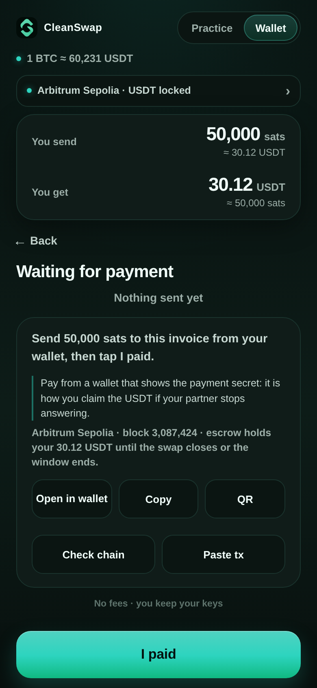

<p align="center">
  
</p>

<h1 align="center">CleanSwap</h1>

<p align="center"><b>Swap bitcoin for USDT — or USDT for bitcoin — with both sides locked before anything moves.</b></p>

<p align="center">
  
  
  
  
  
  
  
</p>

<p align="center">
  
</p>

CleanSwap is a non-custodial **Lightning bitcoin <-> USDT atomic swap**: one HTML file, no framework,
no wallet vendor, no custodian. Three steps - **1 the Lightning invoice, 2 the USDT address,
3 Approve** - and underneath them a Bitcoin-style SHA-256 hashlock that settles both legs with the
same 32-byte secret.

`v0.5.0` is the version that reads the chain. The USDT leg is a real HTLC on **Arbitrum** - the
`CleanSwapHTLC` contract, default network **Arbitrum Sepolia**, switchable to **Arbitrum One** - and
the app no longer believes the phone: the escrow is read over public JSON-RPC, and the swap only
closes when the contract says the USDT is locked for these terms and then claimed.

`v0.5.1` makes **Practice walk that same road**: `Approve` no longer jumps to a finished swap. A
rehearsal parks on the same **Waiting for payment** screen, with the same invoice hand-off, the same
`Check chain` and `I paid`, and closes only when the stand-in escrow says the USDT was claimed. The
two modes differ in exactly two things: `Sample` beside the two inputs, and a stand-in escrow on the
phone instead of a deployed one (so a rehearsal is never written to Recent).

`v0.6.0` is the security pass, from a code review that found the protocol could be talked out of
its own terms. Every item in that review is closed:

* **A code cannot change the setup.** A `cleanswap:` code is a stranger's text: it may state the
  terms, the chain and the escrow it is meant for, but it never switches the network and never
  writes an escrow address. A code naming an escrow this app does not publish, or one that differs
  from the escrow already set here, is refused whole, with the reason on the screen and a
  `SECURITY` line in the log.
* **A Lightning offer is refused.** An `lno1...` offer has no payment hash, and the invoice a wallet
  gets for it carries one of its own, so a swap bound to the offer's bytes would lock the USDT to a
  hash no payment ever moves. Pasting an offer now says so and asks for a hold invoice.
* **The swap id includes the address that funds the escrow.** `sha256(hashlock, sender, receiver,
  token, amount, timelock)`: a third party who copies the terms cannot lock them first and burn the
  id by refunding, because their own address gives the same terms a different id.
* **The window has a floor, a ceiling and a margin.** A code may not leave less than 30 minutes or
  more than 7 days; the contract refuses a timelock past `MAX_TIMELOCK_DELTA` (7 days) as well as
  one inside `MIN_TIMELOCK_DELTA`; and the Lightning invoice has to stay payable at least an hour
  past the window, so paying into the last minutes of the escrow cannot hand the sats over with
  nothing left to claim. A record past its timelock reads as **window closed**, not as locked.
* **The escrow is cross-checked.** Two or more endpoints are asked the same question and the
  answer is believed only when two agree; a single lying node disagrees with the other and the
  screen says the endpoints do not agree instead of showing a lock that is not there.
* **Token movement is checked, not assumed.** `SafeERC20`-style calls that accept tokens returning
  no bool, and a balance-delta check that refuses a transfer which moves less than the agreed
  amount (`FeeUSDT` in the test suite proves it) - the escrow can never hold less than it promises.
* **Paying bitcoin needs a wallet that hands back the payment secret.** The btc2u screen says it
  before the button, because that secret is how the payer claims the USDT if the partner goes quiet.
* **The Android shell is tighter.** `cleanswap:` intents are quoted with `JSONObject.quote` (newlines
  and separators included), and the page is served from the app's own virtual `https` origin instead
  of `file://`, so universal file access is off and the chain reads still work.
* **A dark forest theme.** Obsidian green (`#08100E` to `#0D1C18`, with a soft mint glow at the top),
  mint-emerald accents (`#50D2C1` / `#2DD4BF` / `#10B981`) on the one button that matters, hairline
  borders in `#1A332D`, and text at `#F0FDF9` / `#9CAEA8`. The Android shell's status bar, navigation
  bar and window background follow it, so nothing flashes white on launch.

`v0.6.1` closes the second review, the one that went after what the first pass left standing:

* **A BOLT11 invoice with no `x` tag expires after an hour.** The standard says so (`3600` seconds
  after the timestamp); reading a missing tag as "never expires" was a way past the window check,
  because an invoice that never ends can never end before the escrow window does.
* **The escrow has a reentrancy guard, and refuses a lock nobody could claim.** `lock`, `claim` and
  `refund` carry `nonReentrant`: a token is a stranger's contract, and one that calls back during a
  transfer must not enter a second time. A zero `hashlock` (sha256 never returns zero, so such a
  swap could only ever be refunded) and `receiver == address(this)` (the tokens would be paid back
  into the escrow) are refused at the door. `ReentrantUSDT` in the test suite proves both the
  refusal and that the guard is released when the call ends.
* **A code cannot land on a running swap.** `applyCode` refuses in every phase but `idle`: the terms
  of the next swap cannot be loaded over a swap whose money has already moved.
* **A lock code is parsed as data.** Its query string is built on `Object.create(null)`, needs a
  `key=value` shape, keeps the first of two same keys, and a malformed `%` escape drops that one
  field instead of throwing out of the decoder. The QR is parsed with `DOMParser` and imported, and
  its caption is set with `textContent` - nothing from a payload is ever pasted into `innerHTML`.
* **One endpoint is not a cross-check.** When `rpcQuorum()` falls back to a single endpoint the
  chain line says `one endpoint, no cross-check` and the Setup panel says what that means. A receipt
  and a transaction (`waitReceipt`, `loadTx`) are read by the same quorum as the escrow itself, and
  hex answers are compared in one case.
* **The page carries a Content-Security-Policy.** `default-src 'none'`, its own inline script and
  style as the only code allowed, `data:` images, and `connect-src` limited to the chain endpoints
  (`https:`, or a node on this machine).
* **The Android shell is tighter again.** Safe Browsing is left on, a navigation is handed to another
  app only for `lightning:`, `bitcoin:`, `ethereum:` and `https:` (anything else is refused with a
  toast), `data:` and `blob:` are no longer treated as the app's own document, and the release build
  is shrunk and obfuscated with `proguard-rules.pro` keeping the shell's entry points.
* **One APK workflow, not two.** The duplicate `.github/workflows/build-apk.yml` - a broken copy
  that failed on every push - is gone; `.github/workflows/apk.yml` is the one that builds.

## What it does

* **The same three steps as ever.** `1 Partner's Lightning invoice` (a hold invoice that states its
  payment hash) -> `2 Your USDT address` (the `0x...` that receives the
  USDT on Arbitrum) -> `3 Approve`. Practice and Wallet build the same screen from the same markup;
  a rehearsal cannot teach a different flow than the real thing. The direction flip still reverses
  the steps, `Sample` still exists in Practice and nowhere else.
* **The chain is the referee, and it is asked twice.** The escrow is read with
  `eth_call swaps(swapId)` against Arbitrum's public endpoints (`sepolia-rollup.arbitrum.io/rpc`
  and `arbitrum-sepolia-rpc.publicnode.com` for Sepolia, `arb1.arbitrum.io/rpc` and
  `arbitrum-one-rpc.publicnode.com` for One), with `eth_blockNumber` and `eth_getCode` as the check
  that the endpoint and the contract are really there before anything is approved, and
  `eth_getTransactionReceipt` for a transaction a wallet sent. With two or more endpoints, a state
  that money depends on is believed only when two of them answer the same thing.
* **The swap id is the terms plus the funding address.** `swapId = sha256(abi.encodePacked(hashlock,
  sender, receiver, token, amount, timelock))`. The side that funds the escrow knows the id from its
  own wallet; the other side gets the address from the funding side's code, or from the lock
  transaction itself (its sender is read from the chain). A record found under the id is compared
  field by field - hashlock, sender, receiver, token, amount, timelock - before it is believed.
* **The verdict comes in plain English.** `swaps(id)` returns the whole record; the app compares it
  against the terms on screen (hashlock, receiver, token, amount, timelock) and says one of: nothing
  locked yet / holds your X USDT until the swap closes or the window ends / paid out / sent back /
  not the agreed swap. A record that disagrees with the terms on screen is refused, not guessed
  about.
* **Nothing completes on a tap - in either mode.** In Wallet mode `Approve` is refused outright
  while the USDT is not in the escrow; once the chain says `locked`, the screen waits for the
  bitcoin payment; `I paid` starts a watch on the escrow (12 s poll) and **nothing** - not
  `I paid`, not `Check chain`, not a reload - closes the swap before the contract says `claimed`.
  A refunded record closes it as refunded, and the receipt says so. Practice runs the same
  sequence: `Approve` -> **Waiting for payment** -> `I paid` -> the same reading -> **Swap
  complete**, against the stand-in escrow, at rehearsal speed (a lock and a claim land a moment
  after the tap rather than waiting for a partner).
* **Signing stays in your wallet.** The app holds no key and never asks for one. With a wallet in
  the page (`window.ethereum`, EIP-1193 - an injected browser wallet) the approve/lock/claim/refund
  calls are sent from it, the USDT allowance is checked and an `approve` is requested only when it
  is short. Without one, the exact call (`to`, `data`, `chainId`) is copied as text for another
  wallet app, or opened as an **EIP-681** `ethereum:...` link, and the transaction hash is pasted
  back - the app reads the receipt itself and still judges only what the escrow says.
* **Setup is one panel, used once.** The chain line at the top (Arbitrum Sepolia / Arbitrum One)
  opens it: the escrow contract address, the USDT token address, optional RPC endpoints
  (comma-separated; more than one means a cross-check). With no contract set, the panel offers the
  deploy hand-off: **Copy bytecode** (solc 0.8.26 creation code, embedded in the page) and **Open
  Remix**. The setup survives in `localStorage` under one key, and nothing but this panel ever
  writes it.
* **Only an invoice with a payment hash is accepted.** A BOLT11 hold invoice (`lnbc...`) or a BOLT12
  invoice (`lni1...`) that carries the standard `payment_hash` field; either one names the hash the
  swap locks to. A BOLT12 offer (`lno1...`) is refused with a sentence and an explanation, because
  the invoice it produces gets a hash of its own (see below).
* **The terms leave as a code, not as a web address.** `Share code` copies `cleanswap:...`
  (base64url JSON: both amounts, the window, the hashlock, the USDT address, and in Wallet mode the
  chain, the escrow and the address that funds it - still under the 340-byte QR budget, because the
  hashes and addresses inside are packed as bytes). No host, no path, no name, nothing taken from
  `location.href`.
* **`<- Back` from a running or finished swap** returns to the filled-in form; a swap nobody paid
  is not quietly settled by leaving it.

## The three steps

| Step | On screen | What is checked before `Approve` moves |
| --- | --- | --- |
| 1 | the Lightning invoice - `Open in wallet`, `Copy`, `QR` in both modes, `Sample` in Practice only | bech32 checksum, a `payment_hash` present (an offer is refused: it has none), amount equal to the swap, not expired, `bc` network, an expiry at least an hour past the escrow window, and - when a code arrived first - a hash equal to the one that code pinned |
| 2 | the USDT address | an Arbitrum `0x` address with exactly 40 hex characters, not the zero address. In Wallet mode a TRON `T` address is decoded and checked, then refused with the reason: this swap pays on Arbitrum |
| 3 | `Approve` | the two are bound to one `H`, the window is neither too short nor too long, and in Wallet mode the chain is asked before anything else happens: endpoints alive and agreeing, contract deployed, escrow state for `swapId` |

Anything refused is named in plain English and never in jargon, and the hidden log keeps the decoded
fields for a support question.

## Wallet mode - the real escrow

<p align="center">
  
</p>

A swap in Wallet mode runs on the chain, and every step that touches USDT has the contract behind it:

1. **You send bitcoin** (`btc2u`): the *partner* locks the USDT first. `Approve` reads the escrow;
   nothing there (or a record for different terms) stops the swap with a sentence. Once the chain
   says `locked`, the screen becomes **Waiting for payment**: the invoice, `Open in wallet` /
   `Copy` / `QR`, and `I paid` below.
2. **`I paid` starts the watch.** The screen changes to **Paid, waiting for the USDT** and polls the
   escrow every 12 s. When your partner reveals the secret R in a `claim`, the record flips to
   `claimed` and the swap closes - on the chain's word, not yours. `Check chain` reads it sooner;
   `Paste tx` takes a transaction hash instead.
3. **You send USDT** (`u2b`): `Approve` builds the `lock()` call from the terms on screen. With a
   wallet in the page, the allowance is checked first and the approve + lock are sent from it;
   without one, `Copy call` / the `ethereum:` link carry the call to another wallet and `Paste tx`
   brings the hash back. The app reads the receipt, then the record: only `locked` moves the swap
   to waiting, only `claimed` completes it.
4. **The window runs out**: the refund button appears for your side of the escrow, and a record
   that says `refunded` closes the swap as **Swap closed**, with the receipt saying the USDT went
   back.

<p align="center">
  
</p>

Completed swaps land as one-line entries under **Recent**, and the receipt names the chain it
settled on (`Arbitrum Sepolia · paid on chain`).

**Practice mode** runs the identical screen, gates and readings against an in-page stand-in for the
escrow: the same `swaps(id)` record shape, the same classifier, the same sentences, the same
**Waiting for payment** / `I paid` / **Paid, waiting for the USDT** screens. The chain line at the
top names Arbitrum Sepolia and the stand-in escrow, so nothing has to be deployed to rehearse. The
receipt says `Practice · simulated`. A rehearsal is never written to Recent.

---

## On-chain architecture (Arbitrum Sepolia / Arbitrum One)

```
   bitcoin leg (Lightning)                    USDT leg (Arbitrum)
   -------------------------                  -------------------------
   invoice, payment_hash H          <------>  CleanSwapHTLC.lock(H, T2, receiver, token, amount)
   paid by the BTC payer                      swapId = sha256(H ‖ sender ‖ receiver ‖ token ‖ amount ‖ T2)
            |                                          |
            |  the same 32-byte secret R               |  claimed: swapId, R
            v                                          v
   whoever holds R settles both         CleanSwapHTLC.claim(swapId, R): sha256(R)==H,
   (reveal R in the claim)              USDT transferFrom escrow to receiver, Claimed(R)

   timeout path:            CleanSwapHTLC.refund(swapId) after T2 - tokens back to the sender
   app's view of it all:    eth_call swaps(swapId) - 8 words: hashlock, amount, timelock,
                            token, sender, receiver, claimed, refunded
```

* **The swap id is computed off the terms and the funding address.** Both phones compute
  `sha256(abi.encodePacked(hashlock, sender, receiver, token, amount, timelock))`. The funding side
  knows `sender` from its wallet and puts it in its code; the other side learns it from that code or
  from the lock transaction. The `sender` is what stops a third party from locking the same terms
  first and refunding them later: with a different sender they get a different id, and the real lock
  is unaffected.
* **Arbitrum parameters.** Sepolia test chain id `421614` (`0x66eee`), One mainnet chain id
  `42161` (`0xa4b1`). Both are offered in Setup, Sepolia by default; the mainnet token is the
  6-decimal USDT at `0xFd086bC7CD5C481DCC9C85ebE478A1C0b69FCbb9` (the app also reads `decimals()`
  semantics at 6 and shows the USDT amount the way a wallet does).
* **Public endpoints, cross-checked.** Sepolia: `sepolia-rollup.arbitrum.io/rpc` and
  `arbitrum-sepolia-rpc.publicnode.com`. One: `arb1.arbitrum.io/rpc` and
  `arbitrum-one-rpc.publicnode.com`. Endpoints typed in Setup replace them all - a person who runs
  their own node did not ask for a public one to be asked instead, and one endpoint is its own
  answer. With more than one, `swaps(id)`, `eth_blockNumber` and `eth_getCode` are asked of all of
  them and believed only when two agree; otherwise the screen says the endpoints disagree and
  nothing is approved. A failed request walks to the next endpoint for the calls that are not part
  of that cross-check.
* **No key ever enters the app.** EIP-1193 injection (`window.ethereum`) sends what the page cannot
  sign; everything else is a copy/link/paste hand-off. The app reads, computes and judges; the
  wallet signs.
* **`contracts/CleanSwapHTLC.sol`** - `^0.8.26`, custom errors, packed struct, one slot of
  booleans, checks-effects-interactions, no owner, no fees, no proxy. `lock` pulls the token via a
  checked `transferFrom`, `claim` reveals R and pays the receiver, `refund` returns to the sender
  after `timelock`; `swaps(swapId)` is the public getter the app reads; `computeSwapId(...)` mirrors
  the app's own packed SHA-256. Token movement goes through `_safeTransfer`/`_safeTransferFrom`:
  a token that returns no bool is accepted, and any transfer whose actual balance movement is not
  the agreed amount reverts (`TransferAmountMismatch`). Events: `Locked`, `Claimed` (with R in the
  clear), `Refunded`. `contracts/TestUSDT.sol` is a throwaway 6-decimal ERC-20 with `faucet()` for
  Sepolia, beside `FeeUSDT` (1% on every transfer) and `QuietUSDT` (returns no bool) for the tests.
* **Timelock bounds are the safety margin**: the contract refuses a timelock closer than
  `MIN_TIMELOCK_DELTA` (5 minutes) so a refund cannot race a claim, and one further than
  `MAX_TIMELOCK_DELTA` (7 days) so the funding side's money cannot be parked for a season. The app
  applies the same floor and ceiling before it lets anyone approve, and refuses an invoice that does
  not stay payable at least an hour past the window.

### Lightning side: a payment hash or nothing

One reader parses everything - `lno1…` (BOLT12 offer), `lni1…` (BOLT12 invoice), `lnbc…`/`lntb…`
(BOLT11), with or without the `lightning:` prefix - and the swap gate accepts only a string that
states its own payment hash.

* **BOLT11 encode** (`lnbc…`) — hold invoices: bech32 checksum, 35-bit timestamp, `p`/`d`/`x`
  tagged fields, a 65-byte signature slot, `payment_hash = H`, and an expiry that has to outlive the
  escrow window.
* **BOLT12 invoices** (`lni1…`) are read through the standard `invoice_payment_hash` (TLV 168).
  The app's own type-80 tag is reported separately and is never mistaken for the payment hash.
* **BOLT12 offers** (`lno1…`) are recognised and **refused**. An offer cannot carry a payment hash,
  and the invoice a wallet gets for it is built by the payee's node with a fresh random hash, so
  hashing the offer's own bytes would lock the USDT to a hash no Lightning payment ever moves. The
  refusal says what to ask for instead: a hold invoice made for this swap.
* Wallet hand-off: `lightning:<invoice>` deep link, one-tap copy, and a locally generated QR
  (own encoder, byte mode, EC level M — falling back to L for long requests — versions 1–13).

> Honest limit: invoices the app mints carry deterministic filler signatures; they parse, checksum
> and hash correctly, but no node will route them. They exist to exercise the gate and the screen.

### What the screen deliberately hides

The verification did not get weaker, it moved out of sight. The hidden event log (`#log`) records
every decoded field, hash comparison and refusal for a support question. Addresses, hashes and
selectors appear only where the person swapping needs none of them: the Setup panel (deploy), the
copied call (wallet hand-off) and the log.

---

## Repository layout

```
ln-usdt-swap.html            built single-file app (also dist/cleanswap.html)
build.py                     src/ -> single file (+ the APK asset); refuses to emit Hangul;
                             compiles the escrow and embeds its creation bytecode
src/
  index.template.html        screen markup: two cards, three steps, one Approve bar, the setup panel
  app.css                    dark forest theme (obsidian green, mint accents), fixed action bar, mobile-first
  app.js                     JSON-RPC client, escrow ABI + swap id, gates, BOLT11/12, wallet hand-off
  qr.js                      dependency-free QR encoder (byte mode, 1-13, L/M/Q/H)
contracts/
  CleanSwapHTLC.sol          sha256 hashlock, ERC-20 escrow, timelock refund, swaps(id) getter
  CleanSwapHTLC.bin          creation bytecode, checked against the source by the build and the tests
  TestUSDT.sol               6-decimal faucet token, plus FeeUSDT, QuietUSDT and ReentrantUSDT for the escrow tests
docs/                        icon and screens, regenerated from the built app
tools/                       invoice minting, icons, QR and doc-shot helpers
test/
  headless.js                Playwright end-to-end suite, with a mock JSON-RPC endpoint on 127.0.0.1
  contract-evm.py            contract behaviour on py-evm + the page's ABI against eth_abi
  qr-crosscheck.py           QR matrices vs python-qrcode (64 fixed-mask matrices)
  invoice-crosscheck.py      minted invoices vs an independent BOLT11 decoder
  verify-english.py          Hangul must be 0 in every text file, path and commit
  run-all.sh                 everything above with the right env
android/                     WebView wrapper (com.jbitmstr.cleanswap, v0.6.1, versionCode 10)
```

## Build

```bash
python3 build.py     # -> ../ln-usdt-swap.html, dist/cleanswap.html and the APK asset
```

solc 0.8.26 (`.tools/solc-*` or `$SOLC`) compiles the escrow; its creation bytecode is embedded in
the page for the Setup panel's deploy hand-off, and `contracts/CleanSwapHTLC.bin` is checked against
the same source. The output is one self-contained file. Network use: the optional BTC/USD quote from
`mempool.space`, and the Arbitrum JSON-RPC reads of the escrow. The build fails if any source file
contains a Hangul character.

## Verification & test results

All suites pass on this tree:

| Suite | What it proves | Result |
| --- | --- | --- |
| `test/headless.js` (Playwright + a mock Arbitrum JSON-RPC endpoint on 127.0.0.1) | The three steps in both modes, the flip, invoice and address refusals, BOLT12 offers refused (never bound to a made-up hash), the `cleanswap:` code round trip (chain, escrow and funding address included, still QR-sized), a code that tries to write an escrow, another chain or a 5-minute or 8-day window refused with the setup untouched, a code refused while a swap is running, Practice walking the same road (Approve -> the waiting screen with `I paid` -> the lock alone finishing nothing -> the stand-in claim completing the swap, no Recent entry, and no request leaving the phone), and the whole wallet flow against real `eth_call` responses: nothing locked -> Approve refused; `locked` -> the payment starts; `I paid` -> watching, no receipt; endpoint down -> nothing completes and the line says why; record for another amount -> refused; `claimed` -> the swap completes and the receipt names the chain; the USDT side: the lock call (copy / EIP-681 / ABI shape), a pasted tx hash read back through `eth_getTransactionReceipt`, a wrong secret refused before any wallet sees it, and a `refunded` record closing the swap as refunded. Plus the review items: an invoice with no `x` tag read as expiring in an hour and refused for a two-hour window, one endpoint saying `no cross-check`, a lock code with a broken escape / `__proto__` / no `=` / a duplicate key, a QR whose caption stays text, and the page's own Content-Security-Policy blocking an outside script while its inline code still runs | **299/299 pass** |
| `test/contract-evm.py` (solc 0.8.26 + py-evm + eth-abi) | Real bytecode: `lock` escrows and debits, `swaps(id)` returns the 8-word record and eight zero words for an unknown id, `claim` with the right preimage pays the receiver and emits R, double claim reverts, refund before/after the timelock, `computeSwapId` = the id `lock` used (and a different id for another sender), `MAX_TIMELOCK_DELTA` refusing an 8-day timelock, a fee-on-transfer token refused and a token that returns no bool accepted, a zero hashlock and a receiver that is the escrow itself refused, a token that re-enters `lock` mid-transfer refused with nothing escrowed (and the same token accepted when its call-back is harmless) - and every selector the page sends equals keccak of the contract signature, the committed bytecode matches the source, and the mock endpoint's answer equals what `eth_abi` encodes for the same record | **48/48 pass** |
| `test/qr-crosscheck.py` | Every module of every mask (0–7) across eight payloads matches `python-qrcode` | **64/64 matrices equal** |
| `test/invoice-crosscheck.py` | Every invoice the app mints parses under an independent Python BOLT11 decoder | **45/45 pass** |
| `test/verify-english.py` | Hangul count is 0 across every tracked text file, file name and commit message | **0 characters** |

```bash
bash test/run-all.sh      # build + English + headless + EVM + QR + invoices
```

Screenshots of the form, the wallet flow (waiting, paid, settled, refunded), the setup panel, the
blocked form, the lock hand-off and the code QR are written to `shots/v5*-*.png` by the headless
suite.

## Deploying the escrow (once per network)

1. Wallet mode -> the chain line -> **Setup**.
2. Pick the network. **Copy bytecode**, open **Remix**, paste it as one file with the `// SPDX`
   line removed (or paste `contracts/CleanSwapHTLC.sol` from this repository and compile with
   solc 0.8.26), deploy with your wallet - Sepolia for a rehearsal.
3. Copy the deployed address, and the token address (deploy `TestUSDT.sol` on Sepolia and tap its
   `faucet()`; on One it is USDT's own contract), into Setup and **Save**.
4. `Check` reads the chain and tells you the escrow has code. Everything else stays on the phone;
   the other phone learns the address from a `cleanswap:` code.

## Android wrapper

`android/` is a dependency-free `WebView` shell (package `com.jbitmstr.cleanswap`, `versionName
0.6.1`, `versionCode 10`). The shell owns the hand-offs the WebView cannot: `lightning:`, `bitcoin:`
and `ethereum:` links (the EIP-681 call) become an `ACTION_VIEW` intent, so **Open in wallet**
and the escrow call open the installed wallet instead of failing with
`net::ERR_UNKNOWN_URL_SCHEME`; a phone with no such app gets a toast rather than a crash, and the
manifest declares a `<queries>` entry for all three schemes so Android 11+ package visibility does
not hide them. The scheme list is an allowlist - `lightning:`, `bitcoin:`, `ethereum:` and `https:`
and nothing else - so a link the page never needs cannot reach an app on the phone. The page is
served to the WebView from the app's own virtual origin (`https://appassets.androidplatform.net`,
answered by the shell from `assets/index.html`), not from `file://`, so file access and universal
file access are both off while the chain reads and the quote work as ordinary CORS requests, and
`data:`/`blob:` documents are not treated as the app's own page. Safe Browsing stays on. `cleanswap:`
intents are quoted with `JSONObject.quote`, and a code handed over by another app opens CleanSwap on
it. A release build is minified and shrunk by R8 with `proguard-rules.pro` keeping the shell's entry
points.

GitHub Actions builds `cleanswap.apk` on every push to `main` and on `v*` tags
(`.github/workflows/apk.yml`); the same file is kept under `android/ci/build-apk.yml` for reference.
The APK is uploaded as a workflow artifact.

## Security notes and limitations

* This is a **prototype**. The contract is minimal by design and **has not been audited**; do not
  escrow real value with it. On Arbitrum One, real USDT is real money.
* The app reads the chain and builds calls; it never signs. Anything it says is settled on-chain is
  read from the contract, and everything else it says is a sentence, not a receipt.
* The read path is the page's own JSON-RPC client against public endpoints (or the ones you set).
  With two or more endpoints the state is read by quorum, so one lying node is caught by the
  disagreement, and so are receipts and transactions. With a single endpoint that node is trusted by
  definition: the chain line says `one endpoint, no cross-check` and Setup says the same, so the
  screen never claims a cross-check that did not happen. Run your own node for real value.
* The escrow guards `lock`, `claim` and `refund` against re-entry, and refuses a zero hashlock or a
  receiver that is the escrow itself. It is still not audited.
* The page runs under its own Content-Security-Policy: no script, style or frame from another
  origin, `data:` images only, and connections only to the chain endpoints. A code, an invoice or a
  lock code is a stranger's text and is parsed as data - never as markup (the QR is imported as an
  SVG document, its caption set as text).
* A `cleanswap:` code carries terms only. It is not a web address, has no host, and is never built
  from the page's own URL - and it never changes the setup: the chain and the escrow in a code are
  requirements that must already match, not settings that get written.
* A swap lives in the page: reloading it forgets it. The Setup panel is the only thing kept, in one
  `localStorage` key.
* Minted offers and invoices carry deterministic filler signatures; they parse, checksum and hash
  correctly, but no node will route them.
* The UI, code, tests and commit messages are English only, and `test/verify-english.py` enforces it.

## Contributors

- [@JBITmstr](https://github.com/JBITmstr)
- Gilbert ([Pickle](https://pickle.com))

## License

MIT for the code in this repository. The CleanSwap name and icon belong to the project owner.
